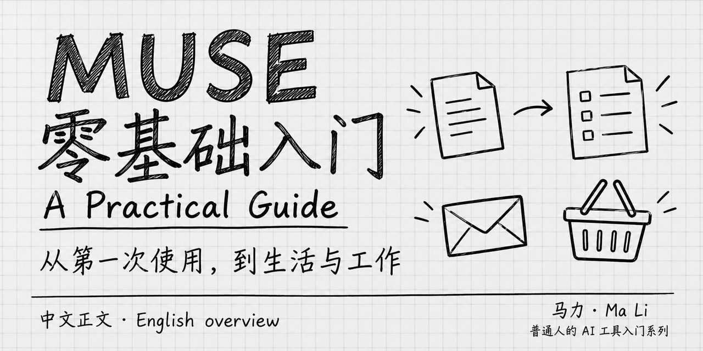

# Muse 零基础入门

简体中文 · [English overview](README.en.md)

 <strong>马力</strong>

**Muse 能替你做什么？怎样开始用？别人已经拿它做了哪些有意思的事？** 这本书从生活和工作的具体任务讲起，适合会用电脑、手机，却还没接触过 Muse 的读者，不要求编程基础。

**[开始阅读完整图文版 →](全书.md)**

**2026 年 10 月更新 · 22 章，26 个单元 · 108 条案例 · 12 张教学插图。** 免费阅读；产品账号的可用地区与费用另见[附录](manuscript/reference.md)。这是独立编写的中文公开预览版，非 Meta 官方教程。英文页面为导览，全文为中文。

<!-- growth:entry -->
- **第一次认识 Muse：** [第 1 章：背景、价值与使用场景](全书.md#basics)，再看[第 3 章：把几份通知整理成出行单](全书.md#start)。
- **先找一个有用的案例：** [从哪些案例看起](cases/代表场景与入选依据.md)，或者直接看[家庭简报](manuscript/household.md#c02)、[超市购物车](manuscript/shopping.md#c78)、[检查邮箱与起草回复](manuscript/office.md#c83)。
- **按自己的事情查：** [108 条案例总索引](cases/案例资料集.md)，涵盖家庭、出行、购物、工作、学习、创作、个人事务和小生意。
<!-- /growth:entry -->

## 读完能获得什么

| 你想解决的问题 | 书里怎样讲 |
|---|---|
| Muse 是什么，值不值得了解？ | 先讲产品背景、能交付的结果和具体场景，原理放到最后选读。 |
| 怎样把一件事交给它？ | 从第一次任务讲到补充要求、提供材料、核对成果、保存文件和处理卡住的步骤。 |
| 接邮箱、给权限以后该注意什么？ | 讲清材料范围、许可范围、记忆和持续任务之间的区别，知道该核对什么。 |
| 有哪些值得参考的实际用法？ | 8 章案例按任务分组，说明过程、结果和本人接手的环节，附原文摘录、译文与出处。 |

案例来自媒体实测、网友与创作者分享、官方示例；每条标明来源性质。优先推荐过程清楚、可迁移、有多方使用记述或媒体亲历的场景，也保留失败与限制。**108 条是收录数量，不代表 108 条都已获得广泛认可或经本书独立复做。**

## 按需阅读

第一部分第 1—14 章讲认识与使用，第二部分第 15—22 章收集案例，第三部分是原理选读。先看用途、直接找案例，或者遇到问题再回查，均可。

展开完整目录

<!-- studio:toc -->
共 26 个单元，12 张图。

1. [这本书怎么用](manuscript/now.md)
2. [第 1 章 认识 Muse：背景、用途与值得先看的场景](manuscript/basics.md)
3. [第 2 章 开始使用：入口、账号与第一次设置](manuscript/setup.md)
4. [第 3 章 先完成一件小事：把几份通知整理成出行单](manuscript/start.md)
5. [第 4 章 用到哪里看哪里：对话、任务、文件和设置](manuscript/interface.md)
6. [第 5 章 让结果更合用：补充要求、追问与修改](manuscript/collaborate.md)
7. [第 6 章 给 Muse 合适的材料：文字、图片、链接和文件](manuscript/files.md)
8. [第 7 章 把成果用起来：检查、修改、保存与分享](manuscript/results.md)
9. [第 8 章 任务没做完时：看进度、补信息、接手和停止](manuscript/progress.md)
10. [第 9 章 让 Muse 查自己的资料：邮箱、日历与其他账号](manuscript/connect.md)
11. [第 10 章 让 Muse 对外办事：发送、提交与许可](manuscript/permissions.md)
12. [第 11 章 让 Muse 逐渐了解你：偏好、记忆与主动建议](manuscript/memory.md)
13. [第 12 章 按时继续做：提醒、定期任务与长期目标](manuscript/ongoing.md)
14. [第 13 章 换个设备继续用：手机、网页与 Mac](manuscript/surfaces.md)
15. [第 14 章 日常使用遇到问题：额度、通知、失败与重置](manuscript/maintenance.md)
16. [选一个自己的案例](manuscript/choose.md)
17. [第 15 章 家庭生活：日程、资料、家务和孩子的事](manuscript/household.md)
18. [第 16 章 旅行与出门：行程、票务、餐厅和出门前的信息](manuscript/outings.md)
19. [第 17 章 购物与消费：找货、比价、取消服务和询价](manuscript/shopping.md)
20. [第 18 章 邮件与工作：找重点、备会议、盯期限](manuscript/office.md)
21. [第 19 章 学习与资料：研究、持续跟进和个人播客](manuscript/learning.md)
22. [第 20 章 内容创作：旧材料、新作品和个人项目](manuscript/creation.md)
23. [第 21 章 个人事务：求职、账单、保险和申请](manuscript/career.md)
24. [第 22 章 小生意：网站、客户、经营分析、卖东西和客服](manuscript/business.md)
25. [选读 Muse 如何工作：模型、工具与后台任务](manuscript/principles.md)
26. [附录 入口、费用和常见问题](manuscript/reference.md)
<!-- /studio:toc -->

## 本版依据与核验范围

资料核对至 **2026 年 10 月 4 日**。正文已完成编辑与来源表述复核，12 张插图已逐张检查；**本书尚未在 Muse 账号内实际操作，也未验证中文效果或安排真人试读**。第 2—14 章操作步骤依据官方文档编写，案例结果归属于原分享者。具体未测范围和检查结果见[核验说明](docs/核验范围.md)。

- [官方资料与逐章写作资源](resources/官方资料与逐章写作资源.md)
- [案例来源与索引](cases/案例资料集.md) · [参考来源](参考来源.md)
- [版本说明](CHANGELOG.md)

<!-- studio:release -->
当前维护稿以本仓库为准。

尚未登记已公开的里程碑版本。
<!-- /studio:release -->

## 收藏与反馈

如果这本书对你有用，欢迎点右上角 **Star** 收藏，方便以后按场景查阅。想接收版本通知，可选 **Watch → Custom → Releases**。

发现问题，请在 [Issues](https://github.com/mali9527/muse-full-guide-for-beginners/issues) 写明章节、对应案例、发生的现象与日期；请先去掉账号、联系人等个人信息。[参与纠错](CONTRIBUTING.md)。

<!-- growth:related -->
## 系列教程

- [Codex 完全零基础入门](https://github.com/mali9527/codex-full-guide-for-beginners)：想在桌面上整理文件、处理文档并持续协作时接着看。
- [Claude Code 完全零基础入门](https://github.com/mali9527/claude-code-full-guide-for-beginners)：想从终端开始处理文件、修改项目、检查结果时看。
<!-- /growth:related -->

## 许可

原创正文、原创案例材料与原创教学插图采用 [CC BY-NC-SA 4.0](https://creativecommons.org/licenses/by-nc-sa/4.0/deed.zh-hans)，可按许可进行非商业性分享与改编，须署名、标明修改并以相同方式共享。所学知识和方法可以用于工作；代码、第三方引用与品牌素材的范围和例外见 [LICENSE](LICENSE)。
