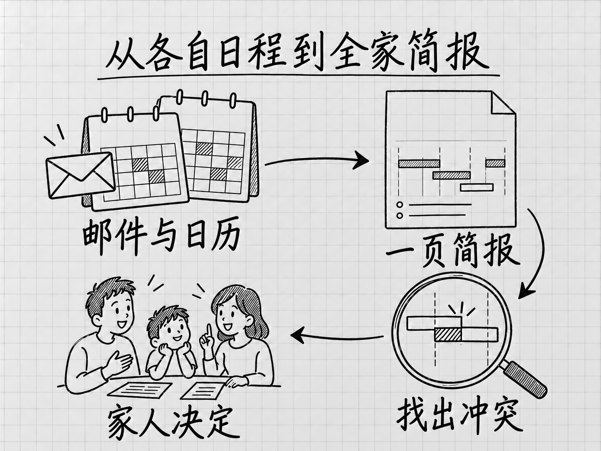

# 第 15 章 家庭生活：日程、资料、家务和孩子的事

<!-- studio:nav -->
← [选一个自己的案例](choose.md) · [目录](../README.md) · [第 16 章 旅行与出门：行程、票务、餐厅和出门前的信息](outings.md) →
<!-- /studio:nav -->

家里的事，麻烦在于散：学校邮件、球队网站、日历、超市促销、搬家清单，各在一处。这一章收的案例，都是有人把这些散的东西交给 Muse，让它读、找、整理，或者到点提醒。

可以从三类任务看起。两位作者都分享过家庭周报，一个打印 HTML 文件，一个要一页 PDF（[C02](#c02)）。联系服务商的三次经历里，Muse 负责找公司、填询价表或发邮件，商家通过电话或短信回复（[C51](#c51)、[C52](#c52)、[C55](#c55)）。整理食谱收藏，则有一位记者和一位网友的经历，可以和官方示例对照着看（[C46](#c46)）。

案例先用中文讲清过程和结果，再附出处；适合短引的原句另配译文。你可以先看故事，需要细节时直接打开来源。

| 你想处理的事 | 从这里开始 |
|---|---|
| [全家的日程与孩子的事](#family-schedule) | [家庭周报（C02）](#c02) |
| [食谱、回访邮件与家庭资料](#family-materials) | [食谱整理（C46）](#c46) |
| [搬家、找人上门与预约](#family-services) | [搬家安排（C01）](#c01) |
| [家庭目标与日常安排](#family-routines) | [家庭目标（C54）](#c54) |
| [需要额外搭建的玩法](#family-extra) | [厨房信息屏（C41）](#c41) |

## 全家的日程与孩子的事

### C02 做一份全家能一起看的每周简报

网友分享 · Reddit r/MetaAI · CaptainBroccoli · 发表日期未确认；创作者分享 · ChatPRD · Claire Vo · 2026-09-16

**事情。** 一周里全家的日程、天气、交通、本地新闻，想放在一张纸上。

**过程与结果。** CaptainBroccoli 让 Muse 每周读家庭的 Google 日历，汇总天气、每天的活动、可能的交通冲突、本地球队比赛、县里的新闻，再加几个和儿子聊天的「餐桌话题」，生成 HTML 网页文件，也就是能用浏览器打开的页面，他每周打印。Claire Vo 的做法相近：接入日历和邮箱后，她要一页像简报一样的 PDF，放在厨房桌上；结果里有一周安排，还标出了巴西柔术课和钢琴课时间重叠。CaptainBroccoli 说自己受了 Claire 的启发，两种做法放在这里对照。

<!-- diagram: FIG-009 -->

*图：C02 的任务流程示意：汇总邮件和日历、在简报里看见时间冲突，再由家人决定怎样调整。*
<!-- /diagram: FIG-009 -->

原文（CaptainBroccoli）：

> One more thing I forgot - a family weekly newsletter. Muse reads our family Google Calendar each week to summarize the weather, family events each day, any potential transportation conflicts, when our local sports teams are playing, local news from our county,  and also includes fun “table topics” to chat about with our son!
>
> It creates this as an HTML file that I print each week!

译文：还有一件忘了说的，家庭周报。Muse 每周读我们家的 Google 日历，汇总天气、每天的家庭活动、可能的交通冲突、本地球队什么时候比赛、我们县的新闻，还加上和儿子聊天用的有趣「餐桌话题」。它做成 HTML 文件，我每周打印。

原文（Claire Vo）：

> Y'all, the PDF it generated was beautiful.

译文：各位，它生成的那份 PDF 真漂亮。

出处：[Useful things I've set up with Muse（Reddit r/MetaAI）](https://www.reddit.com/r/MetaAI/comments/1wk92xe/useful_things_ive_set_up_with_muse/)，作者的补充评论；[Claire Vo 的文字实录（ChatPRD）](https://www.chatprd.ai/how-i-ai/meta-muse-review-personal-ai-agent)，「Workflow 1: The One-Shot Family Newsletter」一节；同一期节目也在 [Lenny's Newsletter](https://www.lennysnewsletter.com/p/muse-review-the-personal-ai-agent)。本书读取：2026-10-01、2026-10-04。

提醒：需要接入家庭日历，Claire 还接入了邮箱。Reddit 主帖含推荐码，评论区有人质疑是营销，但没有拿出证明经历虚假的材料。

### C03 比赛前取回孩子球队的名单，还发现赛程表漏了一场

网友分享 · Reddit r/MetaAI · CaptainBroccoli · 发表日期未确认

**事情。** 他是儿子旅行足球队的领队，每周要打印球队名单带去比赛，可名单要到赛前两天才能打印，他总忘。联赛网站没有程序接口。

**过程与结果。** 他给了 Muse 登录凭据，Muse 用浏览器登录联赛网站，找到名单 PDF 并取出来。他设成每周检查：有比赛就去取名单发给他。另一次，他把 TeamSnap 的凭据也给了 Muse，Muse 发现联赛网站上有一场比赛没出现在 TeamSnap 里。原帖只说发现了差异，没说自动补进日程。这两件事原来分别编为 [C03](#c03) 和 C04，现在合在一起。

原文：

> There’s no API or MCP for the soccer league’s website, but Muse was able to browse the site with Chrome, sign in with the credentials I gave it, and navigate to and print the team sheet PDF for me.
>
> I set this on a schedule so it checks each week if there’s a match coming up and if there is, it gets the team sheet for me and sends it to me instead of me searching for it myself. I cannot express to you what a big deal this is.

译文：联赛网站没有 API 或 MCP，但 Muse 能用 Chrome 打开网站，用我给的凭据登录，找到并输出球队名单 PDF。我设成定时任务，它每周检查有没有比赛，有就替我取名单发给我，不用我自己去找。我没法形容这件事对我有多重要。

> So I gave Muse my TeamSnap credentials and it was able to confirm that there was a match on the league website that wasn’t on TeamSnap, which was super helpful to keep things aligned.

译文：于是我把 TeamSnap 的凭据给了 Muse，它确认联赛网站上有一场比赛在 TeamSnap 里没有，这对保持两边一致非常有帮助。

出处：[Useful things I've set up with Muse（Reddit r/MetaAI）](https://www.reddit.com/r/MetaAI/comments/1wk92xe/useful_things_ive_set_up_with_muse/)。本书读取：2026-09-30、2026-10-01、2026-10-04。

提醒：API 是软件开放给其他程序的操作接口；MCP 是让 AI 工具连接外部服务的一种协议。本例只需知道：网站没有提供这类现成连接，于是他让 Muse 登录网页。网站凭据意味着账号访问权，应确认允许它读取和修改的范围。主帖含推荐码，未附连续多周运行的记录。

### C29 开学季的一组委托，和只剩十二小时的试训报名

官方员工经历 · Meta 设计文章 · Mona Sarantakos、Christine Awad · 2026 年 9 月

**事情。** 开学前，学校邮件和学区网站上的事一波接一波。

**过程与结果。** 文章作者是 Meta 产品团队成员。她让 Muse 盯着学校邮件和学区网站，把关键日期放进家庭日历，把要买的用品装进购物车，找打折的卫衣，还订了庆祝开学的晚餐。藏在那些邮件里的，有儿子运动队试训的报名，只剩十二小时就截止。她登机前收到 Muse 的消息，打电话给丈夫，丈夫在截止前四小时交了表。

原文：

> my son's sports tryout, closing in twelve hours

译文：我儿子的运动队试训，离截止只剩十二小时。

出处：[How We Designed Muse（introducing.muse.ai）](https://introducing.muse.ai/)，「Muse Is an Agent That Can Actually Do Things」一节。本书读取：2026-10-01、2026-10-04。

提醒：作者是 Meta 员工，这是官方文章，不是独立用户的分享。用品只写到放进购物车，最后交表的是她丈夫。

### C53 学校门户登录不上，后来靠 Meta 的人帮忙才进去

媒体实测 · Business Insider · Katie Notopoulos · 2026-09-19

**事情。** 她要给孩子报名管乐团，报名表是一份 Google 表单，链接放在学校用的 ParentSquare 门户里。

**过程与结果。** 她平时用 Google 账号登录 ParentSquare，Muse 的浏览器里却没有这种登录方式，卡住了。后来是 Meta 的公关和工程团队帮她登录成功的。文章里还有三件孩子的事：安排蹦床公园的生日会，没办完，还要孩子拿主意、要打电话；追踪女童军的活动通知，Muse 读不到 WhatsApp 群里的消息；续缴女童军会员费，付款页超时，她改用电脑自己交了。

出处：[Business Insider 的 Muse 评测（英文原文）](https://www.businessinsider.com/meta-muse-review-access-to-emails-credit-cards-health-data-2026-9)；[授权中文版（Business Insider 台湾）](https://www.businessinsider.tw/article/7312)。本书读取：2026-10-04。

提醒：学校、社团这类网站各有各的登录方式，Muse 不一定进得去。普通读者没有 Meta 工程师帮忙。

### C118 把全家的安排做成一个每天打开的小网页

媒体实测 · Tom's Guide · Amanda Caswell · 2026-10-04

**事情。** 五口之家的日程散在手机、便签和家人聊天里，她希望大家能自己查看当天安排。

**过程与结果。** 她向 Muse 说明平常一周的活动，请它先做一个 Today 页面，再加入家庭日历、分工、购物清单和餐单。之后有新通知，她继续交给 Muse 修改。她报告重复问询减少了。

提醒：文章没有提供可供本书检查的运行版本，也没有说明家人登录和访问权限的实现。这里记录的是作者的使用经历，不能据此承诺多人共享已经适合所有家庭。

出处：[I used Meta Muse as an AI house manager for my family of five — here’s what happened](https://www.tomsguide.com/ai/i-used-meta-muse-as-an-ai-house-manager-for-my-family-of-five-heres-what-happened)。本书读取：2026-10-04。

## 食谱、回访邮件与家庭资料

### C46 把收藏的食谱变成买菜清单和能搜的菜谱

官方示例 · Meta 发布公告 · 2026-09-08；媒体实测 · Engadget · Karissa Bell · 2026-09-12；网友分享 · Reddit r/MetaAI · wtjones · 发表日期未确认

**事情。** 在 Instagram 和 Facebook 上收藏了一堆食谱视频和帖子，真要做饭时找不到。

**过程与结果。** Meta 的发布公告举的例子是：把收藏的食谱短视频变成买菜清单，建议聚餐菜单，记住朋友的忌口。Engadget 的记者真试了：她让 Muse（她给它起名 boo）把 Facebook 和 Instagram 上的全部收藏过一遍，挑出食谱，整理成按类型分组、带食材和步骤、能搜索的清单，每条还链接回原帖；她用同样的办法把收藏的餐厅帖子按城市整理成了指南。Reddit 上的 wtjones 做的事相近：让它把 Instagram 收藏的视频分类，再用收藏的食谱做了一本菜谱书。

原文（官方）：

> It can turn a recipe reel the person saved on Instagram into a grocery list

译文：它可以把用户在 Instagram 收藏的食谱短视频变成买菜清单。

原文（Engadget）：

> It came back with an organized list of recipes, grouped by type

译文：它交回一份按类型分组、整理好的食谱清单。

原文（wtjones）：

> I had it take all of my Instagram saved videos and categorize them for me. I also had it build me a recipe book from my saved Instagram recipes.

译文：我让它把我 Instagram 收藏的所有视频分类。我还让它用我收藏的 Instagram 食谱给我做了一本菜谱书。

出处：[Introducing Muse（Meta）](https://about.fb.com/news/2026/09/introducing-muse-personal-ai-agent/)，「How It Works」一节；[How to get started with Meta's new AI agent, Muse（Engadget）](https://www.engadget.com/2256577/how-to-get-started-with-meta-s-new-ai-agent-muse/)，文末用途部分；[Top three use cases for Muse（Reddit r/MetaAI）](https://www.reddit.com/r/MetaAI/comments/1wrwwx2/comment/pcv6hrx/) 的评论。本书读取：2026-10-01、2026-10-04。

提醒：官方那句是厂商举例，Engadget 和 wtjones 是实际做的。需要 Muse 能读你的 Facebook、Instagram 收藏，同一账号中心下这些账号可能已经自动连上了。wtjones 没说做了多少条、有没有逐条核对。

### C58 从兽医的回访邮件建一条猫的健康时间线

网友分享 · Reddit r/MetaAI · Bluehens96 · 2026-10-02

**事情。** 猫看过几次兽医，每次的情况散在回访邮件里。

**过程与结果。** 他让 Muse 翻历次就诊后的邮件，做成一份持续更新的资料：猫的健康时间线，下次复诊该问什么，以及下次预约是哪天。

原文：

> Combed through my past vet visit records (post visit emails) and created an ongoing artifact that shows me the timeline of my cat’s health and what to ask about at my next visits. Also shows when the next visit is scheduled for

译文：翻遍了我以前的兽医就诊记录（就诊后的邮件），做了一份持续更新的资料，显示我猫的健康时间线，以及下次就诊该问什么。还显示下次预约是什么时候。

出处：[Top three use cases for Muse（Reddit r/MetaAI）](https://www.reddit.com/r/MetaAI/comments/1wrwwx2/top_three_use_cases_for_muse/?sort=confidence)。本书读取：2026-10-04。

提醒：这是整理记录，不是诊断。整理得对不对，要对照原邮件看。

## 搬家、找人上门与预约

### C01 把搬家打包拆成每天的小任务

媒体实测 · CNN · Lisa Eadicicco · 2026-09-23

**事情。** 她要搬去新公寓，东西还没打包完，又不想一次打包太久。

**过程与结果。** 她告诉 Muse 还剩哪些东西、离搬家还有多少天、希望每次只打包一小会儿。Muse 列出本周每天打包什么、各花多少时间，还提醒她准备入住第一晚要用的那一包。事情停在计划，文章没写她是否按计划搬完。

原文：

> what to pack each day this week

译文：本周每天要打包什么。

出处：[Meta says its Muse AI agent can do things for you. I put it to the test（CNN，经 KESQ 转载）](https://kesq.com/money/cnn-business-consumer/2026/09/23/meta-says-its-muse-ai-agent-can-do-things-for-you-i-put-it-to-the-test/)，「How Muse was helpful」一节。本书读取：2026-09-30、2026-10-04。

提醒：把剩余物品、期限和每天能花的时间交代清楚，再检查计划是否安排得下。

### C51 让它向四家搬家公司发询价，两分钟后电话就来了

媒体实测 · Yahoo Finance · Daniel Howley · 2026-09-23 前后

**事情。** 他要搬家，还没定搬家公司。

**过程与结果。** 他让 Muse 比较本地搬家公司并要报价。Muse 先问了现住址、新住址、几间卧室、有没有楼梯或电梯，以及搬家公司可以联系他的邮箱和电话。然后它找到四家公司，发出询价。他写道，大约两分钟后，两家公司的电话就打过来了。

出处：[Meta's Muse is an impressively capable AI agent, despite some hiccups（Yahoo Finance）](https://finance.yahoo.com/technology/article/metas-muse-is-an-impressively-capable-ai-agent-despite-some-hiccups-173310662.html)。本书读取：2026-10-04。作者在 [LinkedIn 帖](https://www.linkedin.com/posts/daniel-howley-0b117712_metas-muse-is-an-impressively-capable-ai-activity-7508599611520098305-woJg) 里也讲了这件事。

提醒：询价要把你的电话和邮箱交给对方，之后接电话的是你。这篇文章的发表日期在不同页面显示为 9 月 23 日或 24 日。

### C56 搬家报价要物品清单，它替他提交了

网友分享 · Reddit r/MetaAI · BadtimeBanana · 发表日期未确认

**事情。** 搬家公司报价之前通常要一份物品清单。

**过程与结果。** 他说 Muse 从本地排名靠前的搬家公司那里拿到了报价，到了要交物品清单的那一步，也替他提交了。帖子没写最后选了哪家、报价多少。

原文：

> It got me moving quotes from top moving companies in the area and then took care of submitting my inventory to them to get a quote once it got to that step. Was very impressed.

译文：它从本地排名靠前的搬家公司那里给我拿到了报价，到了要提交物品清单那一步，也替我办了。非常惊喜。

出处：[What are you using Muse agent for? How's your…（Reddit r/MetaAI）](https://www.reddit.com/r/MetaAI/comments/1wcb3cq/what_are_you_using_muse_agent_for_hows_your/) 的评论。本书读取：2026-10-04。

提醒：物品清单会影响报价，提交前应检查数量、体积和需要搬运的特殊物品。

### C52 找人拖走院子里的树枝，它替她填了几家公司的询价表

媒体实测 · The Verge · Allison Johnson · 2026-09-23

**事情。** 院子里有一根树枝要清走，她不想自己一家家找。

**过程与结果。** Muse 翻了本地的清运服务，挑出几家，向她要了地址、电话和树枝的照片，然后用这些信息在几家公司的网页表单上提交了询价。有一家很快用短信回复，约了第二天。她说这是她试的五项任务里它最有用的一次。发稿时还没确认清运完成。

原文短引：

> requests for quotes from a couple of companies using online form submissions.

译文：通过网页表单向几家公司提交询价请求。

出处：[Meta's AI agent is a cute little guy who's great at spending my money（The Verge）](https://www.theverge.com/ai-artificial-intelligence/999526/meta-muse-ai-agent-hands-on-shopping)，第四项任务。本书读取：2026-10-04。

提醒：和 [C51](#c51) 一样，询价表里填的是你的真实联系方式。

### C55 要修家里的木饰条，木工第二天就上门了

网友分享 · Reddit r/MetaAI · Ryanmonroe82 · 发表日期未确认

**事情。** 家里要修一处木饰条，他刚拿到 Muse 的使用资格。

**过程与结果。** Muse 给出的用法建议里有一条是「说出要修的东西，它帮你约木工」。他补了几个细节，Muse 做了一张表，记下联系过的公司、电话、预约时间。他说 Muse 刚说联系了几家公司，不到十分钟就有一家打来电话；那位独自接活的木工第二天早上来报价，他同意了，写帖时木工正在家里干活。他后来补充：Muse 是发邮件联系的，有三家没有公开邮箱，Muse 给了电话让他自己打。

原文：

> WITHIN 10 minutes of Muse saying it had contacted some companies I got a call from one of those companies. That company (1-man show carpenter) came out this morning and quoted me, I agreed, and he is at my house now doing the trim.

译文：Muse 说它联系了几家公司，不到十分钟，其中一家就给我打来电话。那是个一个人接活的木工，今天早上来报了价，我同意了，他现在正在我家做饰条。

> email and it gave me 3 companies to call with their phone numbers because they had no listed email

译文：用邮件联系的。有三家没有公开邮箱，它给了我电话，让我自己打。

出处：[What are you using Muse agent for? How's your…（Reddit r/MetaAI）](https://www.reddit.com/r/MetaAI/comments/1wcb3cq/what_are_you_using_muse_agent_for_hows_your/) 的评论和作者回复。本书读取：2026-10-04。

提醒：Muse 没有替他打电话，打电话的是他。写帖时活还没干完。

### C57 搬家后找医生、牙医和兽医，把初诊预约都提交了

网友分享 · Reddit r/MetaAI · Bluehens96 · 2026-10-02

**事情。** 刚搬家，医生、牙医、兽医都要重新找。

**过程与结果。** 他让 Muse 研究附近的医生、牙医和兽医，自己挑了喜欢的，再让它把所有初诊预约请求都提交了。他说现在预约都安排好了。帖子没有贴确认邮件。

原文：

> Just moved so I had it research local doctors, dentists, and vets near me. Once I picked the ones I liked, asked him to submit all of the initial appointment requests for me. I now have all appointments set up

译文：刚搬家，我让它研究附近的医生、牙医和兽医。我挑好喜欢的之后，让它替我提交所有初诊预约请求。现在预约都安排好了。

出处：[Top three use cases for Muse（Reddit r/MetaAI）](https://www.reddit.com/r/MetaAI/comments/1wrwwx2/top_three_use_cases_for_muse/?sort=confidence) 的评论。本书读取：2026-10-04。

提醒：选哪家是他自己定的，Muse 负责提交。同一位作者还讲了几件事，见 [C58](#c58)、[C59](#c59) 和第 21 章。

### C120 给出四组时间和偏好的保姆，登录后让它完成预约

媒体实测 · The Wall Street Journal（Mint 刊载） · Nicole Nguyen · 2026-09-29

**过程与结果。** 她给 Muse 四组日期、时间和偏好的保姆，自己登录托育预约平台后，让它完成预约。随后 Muse 提议把安排加入日历，她才连接 Google Calendar。

提醒：先登录、完成预约、再接日历，是这一次经历的顺序；不能据此认定任意托育平台都能接入。

出处：[I tried Meta’s Muse AI agent. It’s helpful and scary at the same time.](https://www.livemint.com/ai/i-tried-meta-s-muse-ai-agent-it-s-helpful-and-scary-at-the-same-time-11790645582639.html)。本书读取：2026-10-04。

## 家庭目标与日常安排

### C54 给婴儿定睡眠目标，它追问现状再给计划

创作者分享 · ChatPRD · Claire Vo · 2026-09-16

**事情。** 家里有婴儿，想把睡眠安排理顺。

**过程与结果。** 她描述了家里的睡眠情况，Muse 追问现状，然后给出计划并设了提醒。文章只写到计划生成，没有写之后睡眠有没有改善。

出处：[Claire Vo 的文字实录（ChatPRD）](https://www.chatprd.ai/how-i-ai/meta-muse-review-personal-ai-agent)，「Workflow 2: Setting Personal Goals」一节。本书读取：2026-10-04。

提醒：这个例子展示了设定目标和提醒的过程，文章没有提供睡眠改善的结果。

### C59 问一句保姆这周几小时，它就把工资提交了

网友分享 · Reddit r/MetaAI · Bluehens96 · 2026-10-02

**过程与结果。** 他把保姆工资的处理设给了 Muse。Muse 只问他保姆这周工作了多少小时，然后自动提交工资。帖子没说用的是哪个工资平台，也没说付款确认和报税怎么处理。

原文：

> Set it up to run my nanny payroll. It just asks me how many hours she worked and submits the payroll for me automatically

译文：我设置它来处理保姆的工资。它只问我她工作了多少小时，然后自动替我提交工资。

出处：[Top three use cases for Muse（Reddit r/MetaAI）](https://www.reddit.com/r/MetaAI/comments/1wrwwx2/top_three_use_cases_for_muse/?sort=confidence)。本书读取：2026-10-04。

提醒：提交工资前，核对收款人、工时、金额和这次授权包含的动作；提交并不自动说明款项已经到账。

### C28 把助手变成孩子熟悉的青绿色小龙

创作者分享 · ChatPRD · Claire Vo · 2026-09-16

**事情。** 她想让孩子认得这个助手。

**过程与结果。** 她让 Muse 把形象改成一只青绿色的可爱小龙，名字叫 Slime，因为那是孩子最喜欢的毛绒玩具的名字。文章说头像和动画都生成了。这是她自己改的形象，不是孩子使用 Muse 的记录。

出处：[Claire Vo 的文字实录（ChatPRD）](https://www.chatprd.ai/how-i-ai/meta-muse-review-personal-ai-agent)，IMAX 测试前的一段。本书读取：2026-10-01、2026-10-04。

提醒：形象和名字可以在对话里提出修改。改形象不改变它的权限。

## 需要额外搭建的玩法

### C41 把家庭日历做成厨房里每天更新的信息屏

网友分享 · Reddit r/MetaAI · dafugg · 发表日期未确认 · 需要技术条件

**事情。** 厨房里原来挂着一块 Dakboard 信息屏。

**过程与结果。** 他让 Muse 更新家庭日历（他说这很容易），还让它每晚生成一个网页发布到 GitHub，替代了那块信息屏，天气动态显示。他想要的随机世界照片还没补上。这需要自己有屏幕，并把网页放到能持续访问的服务器上，这叫网页托管。GitHub 在这里是作者发布页面所用的平台，并不是 Muse 自带的信息屏功能。

原文：

> I have mine updating the family calendar (easy) and I’ve replaced our kitchen dakboard with a page muse builds and ships to GitHub for me every night. Weather on there is dynamic. The one feature I haven’t asked for yet that we miss is the random world photos but I’ll get to it.

译文：我让我的 Muse 更新家庭日历（很容易），还用它每晚构建并发布到 GitHub 的页面替换了厨房的 Dakboard。上面的天气是动态的。我们想念的随机世界照片我还没要它做，但会做的。

出处：[Useful things I've set up with Muse（Reddit r/MetaAI）](https://www.reddit.com/r/MetaAI/comments/1wk92xe/comment/paov1do/?force-legacy-sct=1) 的评论。本书读取：2026-10-01、2026-10-04。

提醒：同一账号在[另一个讨论](https://www.reddit.com/r/MetaAI/comments/1wcb3cq/what_are_you_using_muse_agent_for_hows_your/)里自称参与过这个产品的基础设施工作，本书没有核实。主帖含推荐码。

### C49 训练结束后，把记录交给它安排下一次

网友分享 · Reddit r/MetaAI · hariboyolo · 发表日期未确认 · 需要技术条件

**事情。** 他用 Hevy 记录健身，想让 Muse 接着安排。

**过程与结果。** 他在 Vercel 上自己搭了一个接口，用来接收各种应用的通知，第一个接的就是 Hevy：训练一结束，Muse 就知道，看一眼记录，再安排下一次训练。帖子没有公开训练方案。

原文：

> made an API for myself on vercel as a catching ground for webhooks (the first one being one for the Hevy app so it knows when I finish a workout, looks at it, and makes my next workout)

译文：在 Vercel 上给自己做了一个 API，用来接收各种 webhook（第一个接的是 Hevy 应用，这样它就知道我什么时候练完，看一眼记录，再安排我的下一次训练）。

出处：[What's the coolest thing you've done with Muse?（Reddit r/MetaAI）](https://www.reddit.com/r/MetaAI/comments/1wjyjxu/whats_the_coolest_thing_youve_done_with_muse/) 的评论。本书读取：2026-10-01、2026-10-04。

提醒：Vercel 是他放置接口的云服务；webhook 可以理解为应用在某件事发生后，主动给另一系统发通知。本例需要自己搭建接收通知的接口，并非直接打开一个 Muse 开关。本书不据此给任何训练建议。

## 线索

下面这些本书只读到转述，没打开原帖。给出链接，读者可以自己去看。

- 用 Muse 做家庭助手，从学校邮件整理孩子的活动和截止日期。[TheMrAIDan 在 X 上的原帖](https://x.com/TheMrAIDan/status/2099871610086080602)，[聚合站 shipwithmuse.live 的转述](https://shipwithmuse.live/builds/eva-family-assistant-on-muse)。
- 口述运动项目，十分钟做出一个个人训练记录页。[Dre Voudouris 在 X 上的原帖](https://x.com/drevoudouriss/status/2101368610039927091)，[聚合站的转述](https://shipwithmuse.live/builds/workout-tracker-in-10-minutes)。聚合站没说清用的是 Muse 还是 Muse Code。
- 一位网友说一天里让 Muse 买了袜子和杂货、订了晚餐、约了保洁，还取消了不需要的服务。Tom's Guide 的[十个用法整理](https://www.tomsguide.com/ai/i-scoured-reddit-for-muse-ai-use-cases-10-that-will-actually-save-you-time)转述自 [X 上的帖子](https://x.com/nicbstme/status/2101738613851803877)，本书没打开原帖。

## 换成自己的事

家庭里可以先挑一件范围明确的整理任务：把一周日历做成简报，把收藏变成清单，或把几封回访邮件排成时间线。[C02](#c02)、[C46](#c46)、[C58](#c58) 展示了这些做法。拿到结果后，对照原材料检查日期、遗漏和对应关系，再用它安排事情。

联系服务商时，Muse 可以接手查找公司、整理需求、填表或起草邮件这几步。[C51](#c51)、[C52](#c52)、[C55](#c55) 的商家通过电话或短信回复，用户再确认报价和上门安排。先想清楚愿意提供哪些联系方式，也给自己留出处理回复的时间。

要它登录某个网站取东西，先想清楚两件事。一是那个网站用什么方式登录，像 [C53](#c53) 那样用 Google 账号登录的门户，Muse 可能进不去。二是你交出去的是什么，[C03](#c03) 交的是球队网站的账号密码。

CaptainBroccoli 还提到一个小设置：把手机的 Action Button 设成长按就打开 Muse，因为开得快，小事也愿意交给它。这不是任务，只是降低了开口的成本。
