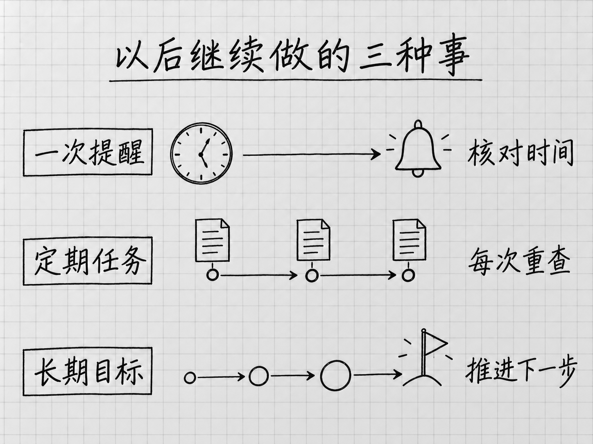

# 第 12 章 按时继续做：提醒、定期任务与长期目标

<!-- studio:nav -->
← [第 11 章 让 Muse 逐渐了解你：偏好、记忆与主动建议](memory.md) · [目录](../README.md) · [第 13 章 换个设备继续用：手机、网页与 Mac](surfaces.md) →
<!-- /studio:nav -->
「明晚提醒我带证件」和「每周替我检查一次活动安排」，看上去都是以后再做，实际需要核对的内容很不一样。前者主要是按时通知，后者还要到时重新取得资料、判断变化，再交付结果。

Muse 的持续使用，可以先分成三类：

| 你要的事 | 需要说清什么 | 应该检查什么 |
|---|---|---|
| 一次提醒 | 什么时候，提醒什么 | 时间、时区和内容 |
| 定期任务 | 多久执行一次，读哪些资料，交付什么 | 执行安排、实际结果和资料新旧 |
| 长期目标 | 最终想达到什么，怎样分阶段推进 | 下一步、阶段进展和是否需要调整 |

官方介绍了按时间或事件继续工作的能力，并提供 **Upcoming** 查看安排、**Goals** 管理目标等入口。[官方：产品设计与持续任务](https://introducing.muse.ai/)

<!-- diagram: FIG-008 -->

*图：提醒核对时间，定期任务核对每次取得的新资料，长期目标核对下一步与阶段进展。*
<!-- /diagram: FIG-008 -->

## 先建立一条能核对的一次提醒

下面是一条教学指令，日期和时区特意写完整：

> 请在 2026 年 10 月 17 日晚上 8 点，按东京时区提醒我：明天出门前带身份证件和已打印的预约确认。只提醒这一次。

Muse 接受后，打开助手头像下的 **Upcoming**（待办安排），核对是否出现对应事项。主要看三个地方：日期是否正确，晚上 8 点有没有被理解成早上，是否只执行一次。文档也允许通过对话要求更新或删除提醒。[官方：提醒与管理入口](https://www.meta.com/en-gb/help/artificial-intelligence/1331373868832401/)

明确城市或时区，是为了避免旅行、搬家或夏令时带来的误会。如果你要的是「无论我在哪里，都按东京时间」，就这样写；如果你要的是「到达目的地后的当地时间」，应说明目的地，并在行程变化后重新核对。

安排列表能帮助确认任务已经建立，但通知是否会在设备上正常出现，还受设备设置和实际执行影响。重要的第一次提醒，应留意是否真的收到；没有收到时，按第 14 章把「没执行」和「执行了但没通知」分开查。

## 定期任务，要交代每次重新做什么

假设你经常给家人找周末活动。只说「每周帮我看看有什么好玩的」，后续结果可能每次都很宽泛，也可能重复推荐看过的活动。可以把需求具体化：

> 从 2026 年 10 月 8 日起，到 11 月 26 日为止，每周四下午 6 点按东京时区，查看我提供的这三个官方活动网站，整理下一个周末适合两名成人和一名 8 岁儿童的活动。
>
> 优先单程交通不超过 45 分钟、总预算不超过 8,000 日元的项目。最多列三项，写明活动日期、地点、价格、预约截止时间和原始链接。每次重新查看当前页面，标出尚未公布或无法确认的信息。先整理，不预约、不付款。

这段指令提供了几个以后仍能检查的条件：每次的资料来源、时间范围、筛选依据、成果格式，以及到何时停止。它们决定了任务是否值得长期保留。

其中「交通不超过 45 分钟」仍需要出发地点和交通方式；「总预算」也可能需要说明是否包含车费、餐饮。Muse 如果追问，应补充这些决定结果的条件。没有追问时，你也可以要求它先列出缺少的信息，再建立安排。

## 第一次跑完，比创建成功更有说服力

定期任务建立后，先核对安排；第一次执行结束，再核对实际成果。两次检查回答不同的问题。

检查成果时，可挑一条建议打开原页，确认活动确实发生在下一个周末，价格对应正确人数，预约仍然开放。再看另外几项有没有重复、遗漏必要条件，是否引用了刚取得的资料。若它只给出了熟悉活动的通用介绍，这还没有完成你要求的定期检索。

第一次结果偏离时，改的是任务本身：缩小信息源、补上出发地点、减少候选数或重写筛选条件。不要仅对这一次结果说「再精简一点」，却让下周仍按旧规则执行。

如果资料来自连接器，还要确认到执行时连接仍有效。长期任务也可能在需要许可、登录或额外信息时等待你，不能把「已建立每周任务」理解成以后无需关注。

[案例 C18](learning.md#c18)和[案例 C38](learning.md#c38)展示了不同形式的持续处理。它们适合帮助你选择任务类型；某位作者收到过一次结果，仍不能证明所有环境下长期执行都同样稳定。

## Goals：目标需要推进，未必需要每天提醒

**Goals** 可以理解为需要一段时间才能完成的目标。它关注「接下来做什么、做到哪一步」，而不是仅在某个时刻发送通知。

比如，你希望四周内整理完家庭照片。可以先让 Muse 帮你把目标拆成几个阶段：确认照片分布、按年份分类、找出重复或模糊照片、整理需要保留的相册。先讨论方案，不立即删除任何照片。

一个清楚的目标，至少要能回答：

- 最终成果是什么：按年份可查的相册，还是一份待筛选清单？
- 现有材料在哪里：手机、硬盘还是云端？Muse 实际能接触哪一部分？
- 下一步是什么：这周先处理哪一批，遇到无法判断的照片由谁决定？

你可以在对话里讨论和调整目标，并在 **Goals** 中查看。官方帮助给出的删除入口是目标旁的三点菜单。若这个目标还配有定期提醒或其他执行安排，删除后应分别检查这些安排的状态，不凭目标名称消失推断所有关联工作都已停止。[官方：管理目标与计划内容](https://www.meta.com/help/artificial-intelligence/2225571704857152/)

## 改计划时，指明要改的是哪一项

「下周先别做了」有几种可能：跳过一次，以后继续；暂停整项任务；永久取消。对人容易省略的意思，交给持续任务时最好说完整。

例如：

> 把「周四查周末活动」这项安排改为每周五下午 5 点，时区不变，截止日期仍是 11 月 26 日。只修改这项，不再保留原来的周四安排。

修改后再看 Upcoming，确认没有同时留下两份。想暂停但找不到对应选项时，直接说明希望停止的时间范围，并核对产品是否实际提供了相应结果；不要自行把「删除」当成具有自动恢复时间的「暂停」。

当任务已经失去价值，结束它也是完整使用的一部分。阅读定期任务成果时，顺手想一下：这份信息是否仍会影响你的决定。连续几次都用不上，就值得修改范围或停掉，让后续提醒只保留真正需要的事。
