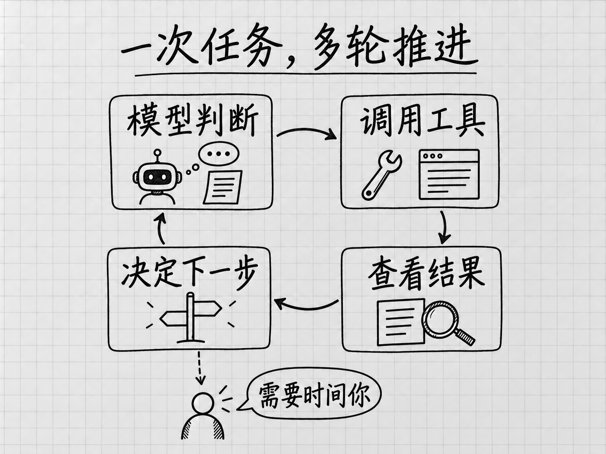

# 选读 Muse 如何工作：模型、工具与后台任务

<!-- studio:nav -->
← [第 22 章 小生意：网站、客户、经营分析、卖东西和客服](business.md) · [目录](../README.md) · [附录 入口、费用和常见问题](reference.md) →
<!-- /studio:nav -->

看过具体用法后，你可能想进一步了解：Muse 为什么能够读材料、打开网站，又为什么有时候需要补信息或等待批准？本篇属于第三部分的原理选读，解释这些工作方式。使用时必需的进度和许可操作，仍分别放在第 8、10 章。

## 从一件任务理解 agent

假设你要把车票、酒店确认邮件和活动通知整理成一份出行单。要完成它，需要读材料、找出日期和地址、把同一天的安排放在一起，再生成文档。如果缺少活动地点，还需要补问或继续查找。

产品介绍把 Muse 称为个人 AI 智能体，英文是 agent。在这个情境里，可以把智能体理解为能够围绕一项任务使用工具、接着推进工作的 AI。它会把你的要求和已有信息连起来，再采取下一步动作。这里用出行单解释工作关系，不代表记录了一次实际执行。[Muse 产品介绍](https://about.fb.com/news/2026/09/introducing-muse-personal-ai-agent/)

## 模型与工具各做什么

AI 模型负责处理信息、理解要求和生成内容。把「整理出行单」理解成有时间顺序的安排，属于这类工作。要真正读取上传的附件、打开网页、生成文件，还需要相应工具。工具让 Muse 能接触材料，并采取具体动作。[Muse 设计说明](https://introducing.muse.ai/)

这些名字很容易混在一起：

| 名称 | 在本书里指什么 |
|---|---|
| Muse | 用户交办和管理任务的产品 |
| Muse Spark | Meta 的 AI 模型，官方说明 Muse 由它驱动 |
| Meta AI | Meta 的另一个助手产品，与 Muse 分别列在官方产品导航中 |

一个模型可以供不同产品使用。知道模型名，仍然不能据此判断某个产品的入口、工具和权限。本书操作以 Muse 为对象。[Muse Spark 官方说明](https://ai.meta.com/blog/introducing-muse-spark-msl/)

回到出行单：直接上传附件，Muse 就有了这次任务的材料；要求它到邮箱找附件，还需要接通邮箱；让它联系酒店，又涉及发信。理解要求、能够访问账号、获准采取动作，是任务中不同的条件。

## 任务为什么需要一轮一轮推进

以出行单为例，Muse 读到活动缺少地点，下一步可以补问；找到新通知后，又要用新时间替换旧时间；生成文件后，还可能按你的反馈调整。一次任务可以看成反复发生的几个步骤：理解目前要求，选择动作，取得动作结果，再据此继续。

<!-- diagram: FIG-012 -->

*图：任务通常要经历判断、调用工具、读取结果，再决定下一步；缺少资料、登录或许可时，仍可能需要你接手。*
<!-- /diagram: FIG-012 -->

这里的关键是“取得结果”。模型认为应该打开某个网站，与网站真的返回了可用内容不同；决定生成文件，与文件正确保存不同。如果某一步没有实际成功，后面再流畅的总结也补不上这段缺口。第 8 章查看活动记录，正是为了知道任务停在了哪个实际环节。

模型生成的内容也可能听起来合理却没有依据。第 16 章 [C64](outings.md#c64) 的电话号码就是一个例子。让它引用原始材料、标明缺失信息，再检查关键字段，是为了把结论与可核对的事实连起来。这些方法可以帮助发现错误，但不能把 AI 变成保证正确的系统。[官方对可靠性与监督的说明](https://www.meta.com/help/artificial-intelligence/1385290430137537/)

## 工作可以在云端继续

Muse 有独立的云端电脑环境和浏览器。官方称它为 Muse Secure VM，本书通常简称「云端电脑」。你通过手机或网页交代事情，它可以在自己的工作环境里处理材料和网站。[官方环境说明](https://about.fb.com/news/2026/09/introducing-muse-personal-ai-agent/)

这有一个直接的使用含义：关闭手机上的窗口，不等于取消已经安排的任务。官方设计说明介绍了后台工作，以及按计划或相关事件继续执行的方式。因此，判断事情是否结束，要看任务状态和已有结果；不再需要的工作，应明确停止或取消。[后台工作说明](https://introducing.muse.ai/)

## 为什么任务会停下来

一次委托需要几个条件接得上。缺少日期或附件，要先补材料；页面要求登录，要先解决访问；下一步超出已有许可，就可能需要你作决定。每次停下来，都要结合进度记录看具体原因。[进度与批准帮助](https://www.meta.com/en-gb/help/artificial-intelligence/1385290430137537/)

批准也有范围。有的只允许一次动作，有的覆盖一项任务，或一个网站、服务的后续动作。Muse 是否重新询问，取决于已有的设置。对话里说「先问我」可以表达要求，管理实际许可仍需要检查相应设置。[批准范围说明](https://www.meta.com/en-gb/help/artificial-intelligence/1385290430137537/)

这些条件也解释了案例为什么必须交代材料和本人接手的一步。同样是整理邮件，上传几份附件与开放整个邮箱，实际范围不同；同样是购物，填好购物车与完成付款，结果也不同。读案例时把这些过程一起看，才容易判断换成自己的事，需要准备什么。
