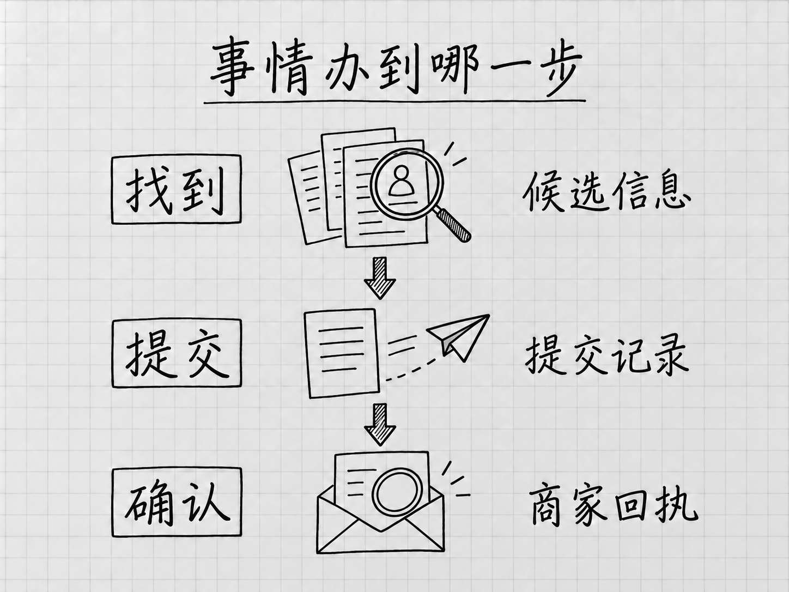

# 第 8 章 任务没做完时：看进度、补信息、接手和停止

<!-- studio:nav -->
← [第 7 章 把成果用起来：检查、修改、保存与分享](results.md) · [目录](../README.md) · [第 9 章 让 Muse 查自己的资料：邮箱、日历与其他账号](connect.md) →
<!-- /studio:nav -->

有些任务发出后很快就有回答，有些会访问几个网站、等你登录，或停在一次批准请求上。此时要先判断正在发生什么，再决定是否催促、补充或重做。

## 先找到停在哪一步

从助手头像进入 Activity log，结合原对话查看这项任务的动作。记录反映过程，交付物或外部回执反映结果。你也可以询问：「这项餐厅查询已完成哪些步骤，现在在等什么？」不要只问「好了没有」，那样得到的简短回复未必能说明障碍。[官方进度帮助](https://www.meta.com/help/artificial-intelligence/1385290430137537/)

| 看见的情况 | 下一步怎样判断 |
|---|---|
| 仍在读取或处理材料 | 看是否有新进展，暂不重复创建同一任务 |
| 缺少日期、人数、文件等信息 | 补充会改变结果的那一项 |
| 需要登录或验证 | 先核对网站与账号，再决定本人接手 |
| 出现批准请求 | 查看动作、对象和许可范围，再作选择 |
| 声称已完成 | 打开成果，或到对应服务核对提交与确认 |
| 报错或进展停止 | 查已执行内容，再判断续做、缩小任务或改由本人完成 |

这些是本书按实际情况整理的判断方式，不代表产品一定使用相同的状态标签。

## 补材料时，把受影响的部分说清楚

假设你原来要找周五晚两个人的餐厅，后来变成四个人，其中一位不能吃海鲜。新的条件会影响候选、座位和菜单，可以这样补充：

> 这项周五晚餐厅查询改成四位成人，其中一位不能吃海鲜。请先按新条件重新检查已有候选，尚未确认前不要联系餐厅或提交预约。

最后一句表达的是委托范围。若你已经给予相关服务持续许可，还应查看现有权限；一条新的对话要求不能保证赶在已经发出的操作之前生效。若有外部动作可能发生，先检查记录，必要时停止再改。

收到补问时也要留意问题指向哪项任务。同时查餐厅与买活动用品，「预算多少」可能属于不同的事情，回答时带上任务名称或对象。

## 网站登录与本人接手

Muse 可以使用自己的浏览器访问网站。这个浏览器的登录状态，与手机上你正在使用的浏览器不一定相同。因此，自己能看到的会员订单，它可能仍需要登录或授权才能查看。

遇到登录要求，先确认域名、服务和账号。用户名、密码等应通过产品提供的专用登录或凭据入口处理，不作为普通聊天材料粘贴。官方安全设计把这类凭据送入专门的存储，并说明用户接手浏览器时，智能体暂停操作。[浏览器与凭据说明](https://research.meta.ai/blog/security-and-safety-for-ai-agents-our-approach-with-muse)

**接手**就是你暂时操作当前网站会话，完成需要本人处理的一步，例如验证身份或检查付款信息。操作前看清当前页面，操作后确认到了哪个状态，再按界面提供的方式把任务交回。若恢复入口不明确，先查看任务状态，不要另开一个重复预约。

[C62](outings.md#c62)记录了订票过程中验证码带来的障碍，[C122](shopping.md#c122)则记录了用户接手支付的过程。它们说明网站任务可能需要人参与，不等于所有网站、账号都有相同的接手步骤。

## 找到、提交和确认分别要看什么

找餐厅可以分成三个结果：列出符合条件的餐厅；把预约申请提交出去；收到餐厅确认。前一项完成，不能替后一项作证明。

<!-- diagram: FIG-004 -->

*图：找到候选、提交请求、收到确认是三个不同进展。检查与当前进展相应的证据，才能知道事情是否办妥。*
<!-- /diagram: FIG-004 -->

收到「已经处理」的回复时，问清楚具体做了什么，并找对应记录。预约看日期、人数和确认状态；邮件看已发内容与收件人；生成文件看实际可打开的文件。还在等商家回复，就保留这个状态，不把待处理写成已成功。

再次尝试之前尤其要查这一点。提交后的网络报错可能让界面看起来失败，但对方已收到申请。若马上重复发起，可能留下两份订单或预约。先查账号记录、确认邮件或商家状态，再决定是否重试。

## 停止任务后，检查已经发生的动作

可以在对话中要求停止或撤销某些动作，例如继续查资料或比价。交代清楚对象：「停止这次周五餐厅查询，保留已经找到的候选。」随后查看任务是否还在运行、是否存在已经提交的内容。[停止与撤销说明](https://www.meta.com/help/artificial-intelligence/1385290430137537/)

对已经发出的邮件，停止后续工作并不能收回收件人看到的内容；对已经完成的购买，则要按商家的取消或退货流程处理。停止、取消订阅和重置 Muse 也分别针对不同对象，第 14 章会集中讲日常管理。

关闭 App 窗口不等于取消任务。官方设计支持后台继续工作，所以离开前若不再需要这件事，应明确结束安排。若仍希望它继续，就保留必要的资料与许可，并在回来时查看实际进展；后台运行不代表任何任务都能无须补问地完成。[后台工作说明](https://introducing.muse.ai/)
